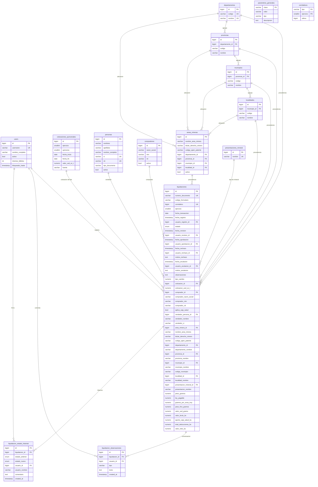

# Diagrama ERD — SINCHI WAYRA (FASE 4)

Fuente: las migraciones de `epcoro-api/database/migrations/2026_10_06_*.php`.
El diagrama se deriva del esquema real, no de un dibujo aparte: si cambia una
migración, cambia este archivo.

Tipos abreviados a propósito (sin precisión) para que el bloque sea legible;
la precisión exacta de cada `numeric` está en su migración.



## Notas que el diagrama no puede decir

1. **Snapshot (columnas `*_nombre`).** `liquidaciones` guarda el nombre junto
   a la FK: `departamento_id` **y** `departamento_nombre`, `area_minera_id`
   **y** `nombre_area_minera`, `vendedor_persona_id` **y** `vendedor_nombre`,
   `comprador_id` **y** `comprador_razon_social`.
   La FK da integridad referencial; el snapshot congela lo que se imprimió
   ese día. Si mañana corrigen el nombre de un municipio, los PDF históricos
   no cambian. Lo mismo en `liquidacion_estado_historial.usuario_nombre`.

2. **Montos calculados persistidos (T3).** `peso_fino_gramos`,
   `valor_usd_gramo`, `valor_bruto_bs`, `aporte_caja_salud_bs`,
   `total_deducciones_bs` y `valor_neto_bs` se guardan y los reportes **no
   los recalculan**: el Excel oficial es la referencia.

3. **ENUM `liquidacion_estado`.** Creado con `DB::statement`, no con
   `$table->enum()`, porque se quiere el tipo nativo de PostgreSQL:
   `creado`, `en_revision`, `revisado`, `aprobado`, `rechazado`,
   `en_correccion`, `anulado`, `eliminado`. Se usa en `liquidaciones.estado`
   y en `liquidacion_estado_historial.estado_anterior/estado_nuevo`.

4. **PKs especiales.** `parametros_generales.clave` es la clave primaria (no
   hay `id`) y `correlativos` es compuesta por `(tipo, ejercicio)`.

5. **Una sola deducción (D1).** Existe `liquidaciones.aplica_caja_salud` y el
   `total_deducciones_bs` guarda ese único monto. **No existe** la tabla
   `liquidacion_deducciones` (la feature de deducciones variables se eliminó)
   ni `aplica_aporte_solidario` / `aporte_solidario_bs`: por D1 el aporte es
   único (1,8 %).

6. **Vista `v_liquidaciones_detalle`.** No aparece en el diagrama porque es
   una vista, no una tabla: aporta los JOIN de `users` (registrado por) para
   que los reportes no los repitan.

7. **Roles y permisos.** Tablas de la FASE 1 (`roles`, `permissions`,
   `model_has_roles`, `model_has_permissions`, `role_has_permissions`), fuera
   del alcance de negocio: un usuario tiene exactamente un rol.

## Cómo verificar que el diagrama sigue siendo cierto

```bash
psql -U epcoro -d epcoro -c "\d liquidaciones"
php artisan test --filter=TablasDeModelosTest
```
